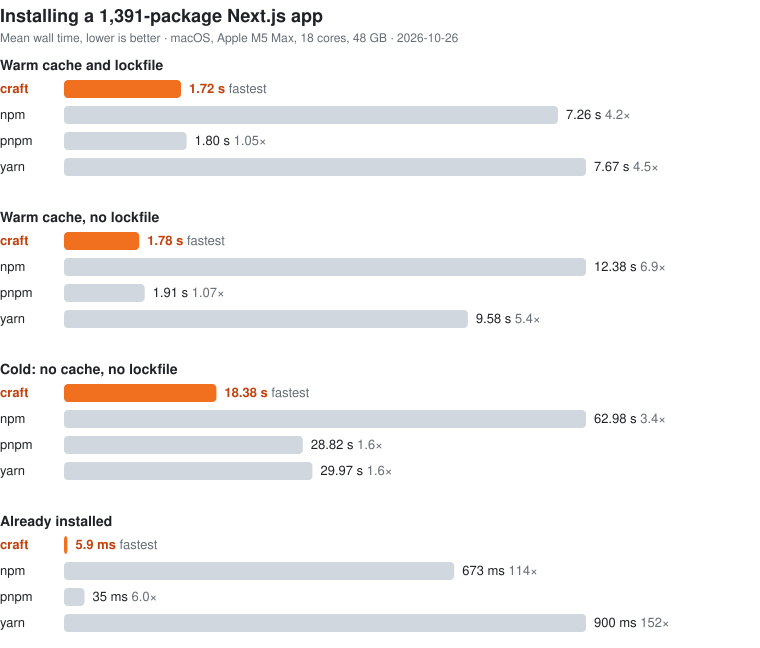

<p align="center">
  
</p>

# 📦 Craft Package Manager


**Craft** is a fast, strict package manager for Node.js, written in Rust. It installs from the npm registry (or any npm-compatible one) into a pnpm-style `node_modules`, keeps a deterministic `craft.lock`, and runs dependency install scripts only for packages you trust.

**📖 Documentation: [craftpkg.github.io/craft](https://craftpkg.github.io/craft/)**

## ✨ Features

- 🚀 **Fast**: parallel downloads, a revalidated metadata cache, and files cloned from a global store. An unchanged project installs in milliseconds.
- 🔒 **Deterministic**: `craft.lock` pins every version, source and integrity hash; installs in CI are frozen by default.
- 📦 **Strict**: every package sees only the dependencies it declares, so undeclared imports fail on your machine, not in production.
- 🛡️ **Safe by default**: tarballs are integrity-checked, and dependencies' install scripts run only when listed in `trustedDependencies`.
- 🧩 **npm-compatible**: ranges, dist-tags, aliases, git, tarball, `file:` and `link:` dependencies, peers, platform packages, and `.npmrc` registries and auth.
- 🖥️ **Everywhere**: native binaries for Linux (glibc and musl), macOS and Windows.

## ⚡ Benchmarks

<p align="center">
  <picture>
    <source media="(prefers-color-scheme: dark)" srcset="docs/public/benchmarks-dark.svg">
    
  </picture>
</p>

- **Warm cache:** 1.72 s with a lockfile and 1.78 s without, the fastest of the four. pnpm takes 1.80 s and 1.91 s, npm and Yarn 7–12 s.
- **Cold install:** 18.4 s, against pnpm's 28.8 s, Yarn's 30.0 s and npm's 63.0 s.
- **Already installed:** 6 ms, 6× faster than pnpm and over 100× faster than npm and Yarn.
- **Memory:** the leanest of the four in every scenario; 71 MB with a warm cache, where npm peaks at 2.9 GB.
- **Behind pnpm** once cached metadata is older than the registry's 5-minute `max-age`: craft checks every package with the registry and takes 7.35 s, while pnpm trusts its cache and takes 1.80 s.

Every project, scenario and peak memory, and how it's kept fair: [Benchmarks](https://craftpkg.github.io/craft/guide/benchmarks) on the website, or the full tables in [`bench/README.md`](bench/README.md).

## 🚀 Installation

```bash
curl -fsSL https://raw.githubusercontent.com/craftpkg/craft/main/install.sh | bash
```

Or download a binary from the [Releases](https://github.com/craftpkg/craft/releases) page. See [Installation](https://craftpkg.github.io/craft/guide/installation) for Windows, checksums and building from source.

## 📖 Usage

```bash
craft init                    # create a package.json
craft install                 # install everything in package.json
craft add react               # add a dependency (-D dev, -E exact, -O optional, -P peer)
craft remove react            # remove one
craft update                  # update within your ranges; --latest to move them
craft run build               # run a script; craft tsc runs a dependency's bin
craft dlx create-vite my-app  # run a package without adding it
craft ci                      # clean, frozen install for CI
```

Every command is documented in the [CLI reference](https://craftpkg.github.io/craft/reference/cli).

## 🤝 Contributing

Contributions are welcome! `make` runs formatting, lints and the full test suite. See the [developer docs](https://craftpkg.github.io/craft/developers/anatomy) for how craft works inside, the test suites and how to work on the docs.

## 📄 License

This project is licensed under the MIT License - see the [LICENSE](LICENSE) file for details.
