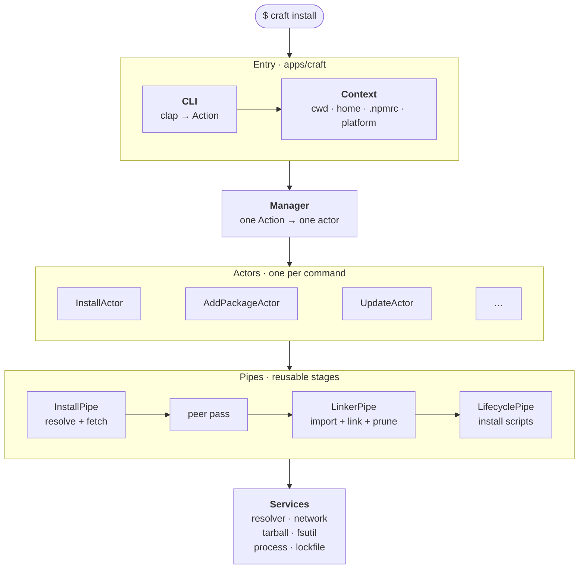
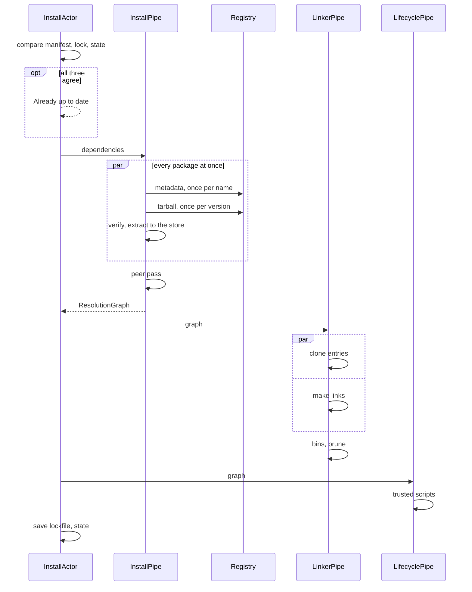
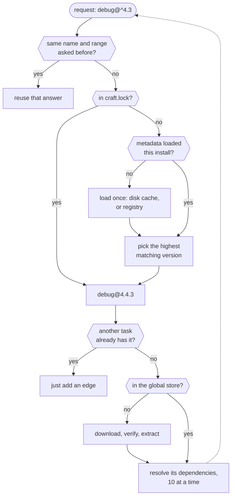
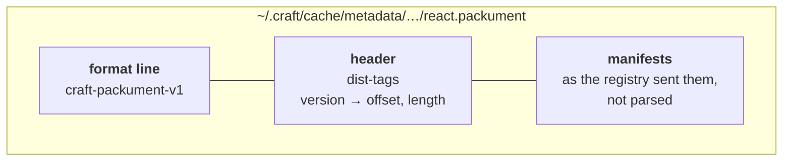
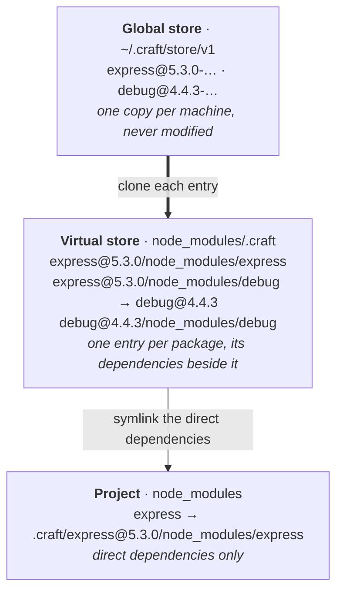

# Anatomy

What happens between pressing Enter on `craft install` and a finished `node_modules`: which part of craft does each step, how the steps overlap, and where the time goes. [How it works](../guide/how-it-works) describes the layout craft produces; this page is about the machine that produces it.

## Layers

craft is a Cargo workspace of small crates, stacked in layers. Each layer talks only to the one below it.



### CLI

`crates/cli` parses the arguments with clap, then `normalize()` folds them into an `Action`, the one enum the rest of craft understands. Shortcuts are settled here, so nothing below has to know about them:

| You type | Action |
| --- | --- |
| `craft` | `Install` |
| `craft install react` | `Add { packages: ["react"] }` |
| `craft start`, `craft test` | `Run { script: "start" }`, `Run { script: "test" }` |
| `craft tsc --noEmit` | `Run { script: "tsc", args: ["--noEmit"] }`, a script or else a bin |
| `craft ci` | `Ci`, a frozen install into an empty `node_modules` |

`main` then builds a `Context` once: the working directory, the craft home, the registry configuration read from `.npmrc`, whether this is CI, the host platform and the progress reporter. It is passed down explicitly. Nothing below `main` reads the current directory or the environment, which is also why every test can run its own isolated install.

### Manager and actors

`CraftManager` matches the `Action` to its actor. An actor owns one command from start to finish:

```rust
pub trait Actor<T> {
    fn with(context: Context, payload: T) -> Self;
    fn run(&self) -> impl Future<Output = Result<()>> + Send;
}
```

An actor decides what the command means: which packages to resolve, whether the lockfile may change, what to write to `package.json`, what to print at the end. It does the heavy lifting by running pipes.

| Command | Actor | Pipes it runs |
| --- | --- | --- |
| `install`, `ci` | `InstallActor` | install → link → scripts |
| `add` | `AddPackageActor` | install → link → scripts, then saves `package.json` |
| `update` | `UpdateActor` | install → link → scripts, without lock preferences for what it updates |
| `remove` | `RemovePackageActor` | none: edits `package.json`, prunes and rewrites the lockfile |
| `run`, `exec`, `start`, `test` | `RunScriptActor` | none: spawns the script with `.bin` on `PATH` |
| `dlx` | `DlxActor` | installs into its own directory under `~/.craft/dlx`, then runs the bin |
| `list`, `why` | `InspectActor` | none: reads `craft.lock` |

### Pipes

A pipe is one stage of an install that produces a value:

```rust
pub trait Pipeline<T> {
    fn run(&self) -> impl Future<Output = Result<T>> + Send;
}
```

`InstallPipe` produces a `ResolutionGraph`: every package instance (`name@version`, plus its peers) and the edges between them. The other pipes only consume that graph, so `install`, `add` and `update` share all of the machinery and differ only in what they feed it and what they keep afterwards.

## An install, end to end



1. **The shortcut.** `InstallActor` compares `package.json`, `craft.lock` and `node_modules/.craft/state` (the lockfile craft last laid out, plus the script policy and whether dev dependencies were left out). When they agree there is nothing to do: two file reads and a string comparison.
2. **Resolve and fetch.** `InstallPipe` walks the dependency tree. Each package's tarball is downloaded and extracted as soon as its version is chosen, while the rest of the tree is still resolving. There is no "resolve everything, then download everything" barrier.
3. **Peers.** A pass over the finished graph resolves every package's peers and gives each distinct peer set its own instance (`react-redux@9.2.0_react@19.1.0`).
4. **Link.** `LinkerPipe` imports each store entry into the virtual store and makes the symlinks, both at once.
5. **Scripts.** `LifecyclePipe` runs the install scripts of trusted packages only, dependencies before their dependents.
6. **Record.** The lockfile and the installed state are written only if their content changed.

## Inside resolution

Resolution is a recursive walk in which every dependency is its own async task. A popular package such as `debug` is reached from many places in a real tree, so the walk is built around never doing the same work twice:



Three tables make that work:

- **Requests**: one slot per name and range. The first task to ask resolves it; every later task with the same request waits on that slot and reuses the answer. The slot is released before recursing, so a dependency cycle finds the node instead of waiting on itself.
- **Metadata**: one `OnceCell` per package name. However many ranges of `debug` the tree asks for, its metadata is read or fetched once.
- **Claimed nodes**: one entry per resolved version. Only the first task to reach `debug@4.4.3` downloads it and walks its dependencies; the others just record an edge.

With a lockfile, versions come from `craft.lock` and no registry metadata is read at all. Packages for another platform (an esbuild binary for Windows on a Mac) are recorded in the graph so the lockfile stays the same everywhere, but never downloaded.

## Metadata, kept lean

A package's registry metadata (its packument) lists every version ever published, and popular packages have thousands. craft asks for the abbreviated form (`Accept: application/vnd.npm.install-v1+json`), which leaves out readmes and everything else resolution doesn't use, and caches it in its own format:



Choosing a version needs only the header. The chosen version's manifest is then read from its offset and parsed, and the other few thousand never are. This is most of why craft peaks at 71 MB on the large benchmark app, where pnpm needs 401 MB and npm 2.9 GB.

The cache honours the registry's `max-age`. Past it, craft asks again with `If-None-Match` and `If-Modified-Since`, and a `304 Not Modified` only refreshes the timestamp. `--offline` and `--prefer-offline` skip the question.

Abbreviated manifests leave out `libc`, which tells a Linux package's glibc and musl builds apart, so for a Linux-only version without it craft fetches that one version's full manifest and caches it beside the packument.

## From the network to the store

- **Bounded requests.** Metadata requests and tarball downloads each run at most `network-concurrency` (16) at a time, with retries and exponential backoff on connection errors, timeouts, 408, 429 and 5xx.
- **Hashed in flight.** A tarball streams into a temporary file beside its store entry and is hashed chunk by chunk as it arrives. Only a file that matched its `integrity` is kept, and no tarball is ever held whole in memory.
- **Extracted on every core.** Gzip and tar are CPU work, so extraction runs on blocking threads, one per core, off the async runtime that keeps the downloads going.
- **Atomic.** A package is extracted into a staging directory and renamed into place, so a store entry is either complete or absent. Any number of concurrent installs can share the store; when two extract the same package, the first rename wins and the other keeps it.

## From the store to `node_modules`

A package travels through three places. The global store holds one copy per machine; each project clones the entries it uses into its virtual store, links every package's dependencies beside it, and links only its direct dependencies at the top:



- **The cheapest import the filesystem has.** On macOS a whole store entry is cloned with a single `clonefile` call, however many files it holds. Elsewhere each file is reflinked (Btrfs, XFS, ReFS), else hard-linked, else copied. The first time a method fails, every later import in the run starts from the next one, so a filesystem without reflinks pays for that failure once, not once per file.
- **Links while importing.** Symlinks may point at entries that aren't imported yet, so imports and links run side by side, each 16 at a time. Bins are linked after both, since linking a bin makes its file executable.
- **Prune only what changed.** A fresh `node_modules` has nothing to prune. Otherwise craft removes the links and entries the new graph doesn't have, and leaves the rest untouched.

## Concurrency at a glance

| Work | At a time |
| --- | --- |
| Top-level dependencies being resolved | 2 × cores |
| A package's own dependencies | 10, and each of those fans out in turn |
| Metadata requests | `network-concurrency`, 16 by default |
| Tarball downloads | `network-concurrency`, 16 by default |
| Extractions | one per core, since they are CPU-bound |
| Imports and links | 16 |
| Install scripts | 8, in waves that run the deepest dependencies first |

## Why it's fast

Put together, those choices are what the [benchmarks](../guide/benchmarks) measure:

- **Doing nothing costs nothing.** An installed project answers in about 6 ms, from two file reads, against pnpm's 35 ms and npm and Yarn's 670–900 ms.
- **One pass, not phases.** Resolving, downloading and extracting overlap, so the network, the CPUs and the disk all work at once.
- **Every piece of work happens once per install.** One metadata load per name, one resolution per range, one download per version, one store entry for every project on the machine.
- **Parsing only what's used.** Abbreviated metadata, read lazily, keeps memory at a fraction of the others' (71 MB against 401 MB and 2.9 GB) and saves the time that parsing would cost.
- **Bytes touched once.** Tarballs are verified while they stream and extracted once into the store; projects get clones, which cost no disk space and almost no time.
- **Native code on every core.** craft is a single Rust binary on Tokio's multi-threaded runtime: no runtime to start before the first request, and hashing, decompression and JSON parsing run in parallel.
- **No cleanup at exit.** Freeing a large graph allocation by allocation takes about a second, so craft leaves it to the operating system, which reclaims the whole process at once.

## Where it's still slow

craft's own roadmap, in the order it will be worked on:

- **Downloads still sit on the resolution path.** A package's dependencies are read from its extracted `package.json`, so on a cold install the critical path is the tree's depth × (metadata + download + extraction). Resolving from metadata alone and fetching every tarball as its own task removes that waterfall.
- **The lockfile is used for versions, not the graph.** `craft.lock` records every package's dependencies, but they're still discovered by extracting each package, which is why npm installs the large app from a lockfile with an empty cache in 12.0 s to craft's 19.8 s.
- **Tarballs are written, then reopened to extract.** Unpacking the response stream directly, while hashing it, saves a write and a read per package.
- **Stale metadata is revalidated level by level.** Past the registry's 5-minute `max-age`, craft asks about each package as the walk reaches it, which costs 7.35 s on the large app to pnpm's 1.80 s. A minimum release age would let a recent enough cache answer without asking.
